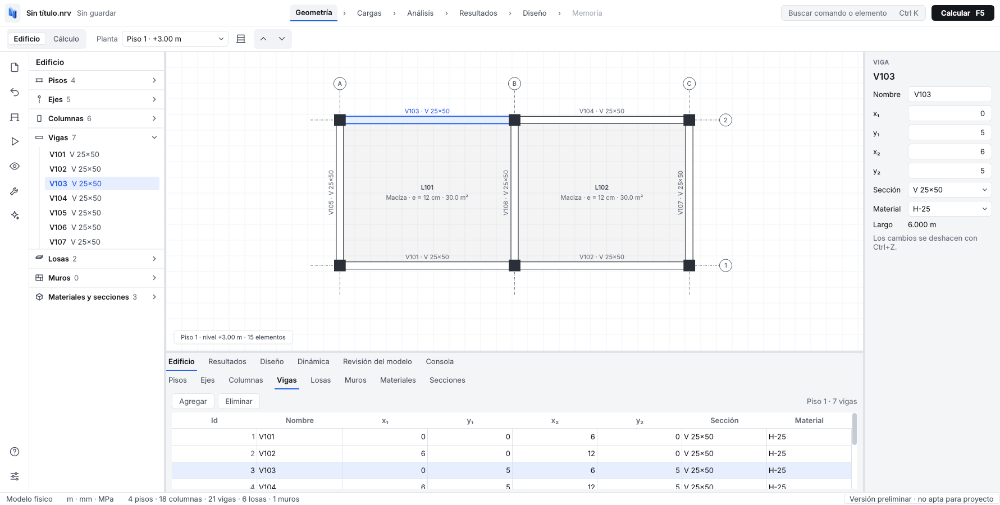
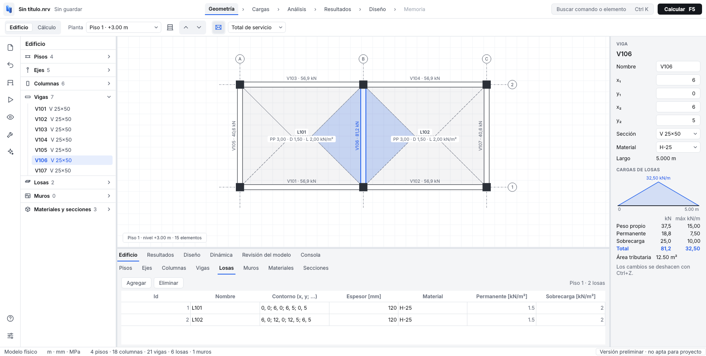
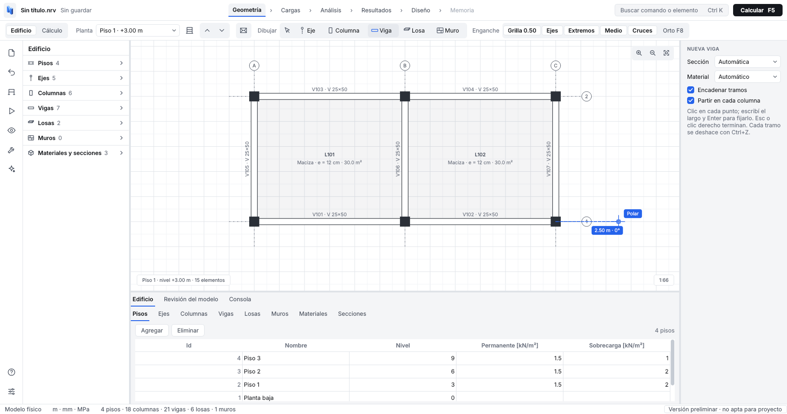
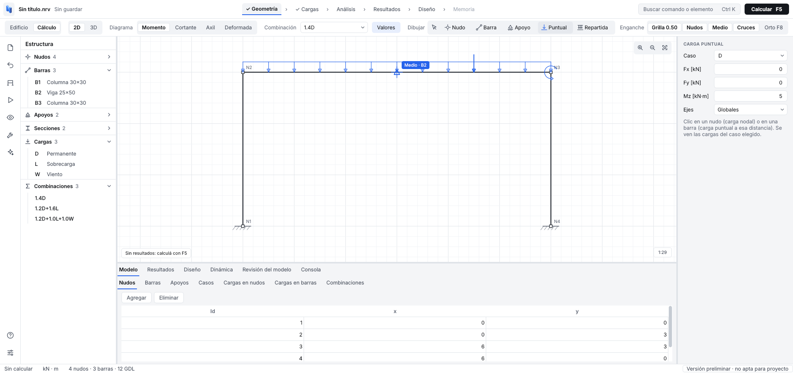

# Diseño de la interfaz de escritorio

Línea de diseño de `nervi.gui`, acordada con el responsable del proyecto el 2026-11-19 (entrada [2026-11-19-03](bitacora/2026-11-19-03-sistema-diseno-interfaz.md)). Todo cambio en la interfaz la sigue y todo control nuevo toma su estilo de este sistema, sin aspecto nativo antiguo. Si hace falta cambiarla, se muestra antes una **muestra visual** (captura o maqueta, en los dos temas), se acuerda con el responsable del proyecto y se documenta acá en el mismo PR.

## Principios

- **Plana, sobria y precisa.** Superficies lisas, bordes finos de 1 px, sin degradados ni sombras dibujadas. Un solo color de acento por tema.
- **Un único sistema.** Los colores, radios y alturas salen de un `Tema` en [`python/nervi/gui/estilo.py`](../python/nervi/gui/estilo.py). No se escriben colores sueltos en otros archivos: los dibujos propios (vista 2D, visor 3D, tablas) leen las constantes de `estilo` (`estilo.PANEL`, `estilo.ACENTO`, `estilo.ESTRUCTURA`…) en el momento de dibujar, así cambian con el tema.
- **Controles completos.** Cada control compuesto se estila entero: flecha del desplegable, botones del campo numérico, marca de casillas y opciones, tirador del deslizador. Si la hoja de estilos de Qt define solo el borde y el fondo, Qt dibuja el resto con el relieve biselado de los estilos viejos (el aspecto "Windows 98"). Las flechas y marcas son SVG que `estilo.iconos` genera con los colores del tema.
- **Toda la aplicación.** La hoja se instala con `estilo.aplicar(app, tema)` sobre la `QApplication`, no sobre una ventana, para que diálogos, menús y listas abiertas también la tengan.

## Temas

| Token | A · Claro preciso (por defecto) | B · Nocturno Nervi (oscuro) |
|---|---|---|
| Fondo de ventana | `#F4F5F7` | `#0B132B` |
| Paneles, tablas, menús | `#FFFFFF` | `#0F172A` |
| Campos | `#FFFFFF` con borde | `#131E36` |
| Bordes | `#DFE3E8` / `#C5CBD3` | `#1F2C47` / `#2A3A5C` |
| Texto | `#14171C` · `#4A5260` · `#6B7280` | `#DCE6F5` · `#A9B8D0` · `#7184A3` |
| Acento (selección, pestaña activa, casillas) | `#2563EB` | `#3B82F6` |
| Foco | `#2563EB` | cian `#00E5FF` |
| Botón primario | negro `#14171C` | azul `#3B82F6` |
| Cumple / no cumple | `#15803D` / `#C2410C` | `#22C55E` / `#F97316` |

El oscuro usa los colores del logo y de la maqueta (azul marino, azul y cian). Se elige en **Preferencias › Apariencia** o en el menú del logo (**Tema claro** / **Tema oscuro**) y se guarda en las preferencias (`interfaz/tema`). **Tamaño de letra** (Normal 9,5 pt o Grande 11 pt) cambia el token `tamano` del tema.

Medidas comunes: esquinas de 6 px (4 px dentro de otro control), controles de 28 px de alto, letra del sistema a 9,5 pt.

## Controles

- **Botones:** secundario (fondo de panel con borde), `primario` (acción principal de la pantalla, uno por zona), `fantasma` (sin borde, para Cancelar), `peligro` (texto en color negativo, para quitar o borrar). Los botones que alternan van como `segmento` dentro de un `grupo`.
- **Etapas:** `etapa`, texto con subrayado de 2 px del color de acento en la activa.
- **Campos, numéricos y desplegables:** misma altura, radio y borde; borde de foco del color de foco; con error, `setProperty("error", True)` pinta el borde del color negativo. Flechas en chevrón fino.
- **Lista abierta del desplegable:** rectangular (es una ventana aparte y no puede tener esquinas redondeadas sin que asomen las de la ventana), con borde en los cuatro lados y la opción elegida con fondo de acento suave.
- **Casillas y opciones:** cuadrado de 14 px con esquinas de 4 px y círculo de 14 px; marcadas, rellenas del color de acento con la marca en blanco.
- **Deslizador:** riel de 4 px y tirador **rectangular** macizo del color de acento (no circular).
- **Pestañas:** texto con subrayado de acento en la activa, sin cajas.
- **Tablas:** encabezados en texto tenue y negrita, filas alternadas con el color de fondo, selección con acento suave. Números alineados a la derecha.
- **Avisos:** `aviso` con fondo, borde y texto ámbar; etiquetas de estado `etiqueta`.

## Menús y ajustes

Decidido el 23/11/2026 con muestras en los dos temas.

- **Barra lateral de menús.** Una columna de íconos de 52 px a la izquierda (`riel`, botones `menu_riel` de 40 px con íconos de 20 px). Arriba: Archivo, Editar, Modelo, Calcular, Ver, Herramientas y Asistente de IA; abajo: Ayuda y Preferencias. Cada ícono abre su menú **hacia la derecha** y muestra su nombre al pasar el mouse; mientras el menú está abierto el botón queda marcado con acento suave y el ícono en color de acento. *Preferencias* abre directamente su ventana. El menú del logo se conserva como acceso rápido.
- **Íconos propios** de 24 × 24 con trazo de 1,7 px (`estilo.ICONOS_MENU`), en el color del texto secundario o del acento. No se copian íconos de otros programas. Desde el 27/11/2026 todos los íconos de la interfaz salen del [catálogo de íconos](iconos.md) (`nervi.gui.iconos`), con las reglas de la familia y los íconos reservados para las fases futuras.
- **Sin tres puntos.** Las entradas de menú y los botones que abren una ventana van solo con su nombre (*Abrir*, *Guardar como*, *Preferencias*, *Plantas*), sin "…" al final. Decidido el 26/11/2026.
- **Solo acciones que existen.** Un menú no muestra opciones grises de cosas que todavía no hace (complementos, por ejemplo); se agregan cuando llegan. *Editar* tiene Deshacer y Rehacer, que muestran qué deshacen o rehacen y quedan inactivos cuando no hay nada.
- **Dos ventanas de ajustes**, con la misma forma: apartados a la izquierda (`apartados`), contenido en cajas (`caja_ajustes`) con título de `seccion`, buscador arriba y *Restablecer este apartado*, *Cancelar*, *Aplicar* y *Aceptar* abajo.
  - **Preferencias** (`ajustes.Preferencias`): de la persona, en esta computadora. Apartados General (qué abrir al iniciar) y Apariencia (tema y tamaño de letra).
  - **Configuración del proyecto** (`ajustes.ConfiguracionProyecto`): dentro del `.nrv`. Apartados Datos del proyecto (carátula de la memoria), Unidades (solo con el modelo vacío, porque cambiarlas exige convertir los valores), Materiales y Diseño (criterios y diámetros permitidos para columnas).
- **Regla para un ajuste nuevo:** si cambiarlo puede cambiar un número del cálculo o de la memoria, va en Configuración del proyecto y en el `.nrv` (con su versión de módulo y migración); si solo cambia cómo se ve o se usa la aplicación, va en Preferencias. Una preferencia se declara una sola vez en `ajustes.PREFERENCIAS` y la ventana se arma sola. Un apartado nuevo aparece recién cuando tiene algo que ajustar.

## Asistente de IA

Decidido el 24/11/2026 con muestras en los dos temas.

- **Ícono en la barra lateral** (`ia`, una chispa), debajo de Herramientas. No abre un menú: abre y cierra el **panel del asistente** junto a la barra, antes del árbol del modelo. Una `insignia` del color de acento sobre el ícono dice cuántas propuestas esperan.
- **Sin chat.** La persona conversa en su propia app de IA; el panel muestra el estado de la conexión (`conexion`, verde cuando está conectada), las **propuestas pendientes** como `tarjeta` con borde y fondo de acento (descripción, origen, resumen de cambios y los botones *Aplicar* `primario`, *Vista previa* y *Descartar* `fantasma`) y las **consultas del agente** (hora, herramienta en `codigo` y ✓ `bien` o ✕ `mal`).
- *Vista previa* abre el modelo propuesto en una ventana aparte, sin aplicarlo. *Aplicar* se deshace con Ctrl+Z.
- Abajo, *Conectar con mi IA* (`primario`) o *Desconectar*, *Cómo conectar mi app* y el aviso de que lo que lee el agente viaja a su proveedor.

## Importar DXF

Decidido el 24/11/2026 con muestras en los dos temas.

- *Archivo › Importar DXF* abre un diálogo con la misma cabecera y el mismo pie que Preferencias (`barra`, `pie_ajustes`): título y nombre del archivo arriba; *Cancelar* e *Importar* (`primario`) abajo.
- A la izquierda, en cajas (`caja_ajustes`) con su título de `seccion`: **Capas** (una casilla por capa con su cantidad de líneas), **Dibujo** (unidad y tolerancia) y **Opciones** (llevar al origen, que solo se ofrece con el modelo vacío, y empotrar los nudos más bajos), y una nota tenue sobre los ejes del dibujo y Ctrl+Z.
- A la derecha, el modelo que quedaría en una vista 2D, recalculado con cada cambio, sin leyenda de resultados. Si el modelo ya tenía barras, las nuevas van en color de acento. Arriba, cuánto se agrega; abajo, los avisos del importador en palabras. Si las opciones no alcanzan (sin unidad, sin capas), el motivo reemplaza al resumen e *Importar* queda inactivo.

## Árbol del modelo

Decidido el 24/11/2026 con muestras en los dos temas (entrada [2026-11-24-07](bitacora/2026-11-24-07-arbol-del-modelo.md)).

- **Panel *Estructura*** (`arbol.ArbolModelo`, nombre de objeto `arbol_modelo`) a la izquierda de la vista, con título `titulo_arbol`. Secciones plegables en este orden: Nudos, Barras, Apoyos, Secciones, Cargas y Combinaciones, separadas por una línea de 1 px del color de borde.
- **Cabecera de sección:** ícono propio de 16 × 16 con trazo de 1,4 px (`arbol.ICONOS_ARBOL`) en texto secundario, título en negrita, contador en texto tenue y chevrón a la derecha (abajo si está abierta, a la derecha si está plegada). Clic en el título: despliega o pliega y, al abrir, muestra su tabla abajo. Clic en el chevrón: solo despliega o pliega. Abren desplegadas Barras, Cargas y Combinaciones, y el árbol recuerda qué abrió la persona mientras dura la sesión.
- **Filas** colgadas de una guía vertical de 1 px: código (`B1`, `N1`, `D`) y detalle en texto secundario (`Columna 30×30`, `Empotrado`, `Permanente`). Con el panel de 300 px o más, a la derecha va un dato tenue (nudos de la barra, coordenadas del nudo, barras que usan la sección); más angosto se oculta en todas las filas a la vez y queda en la ayuda emergente.
- **Dos resaltados:** la barra o el nudo elegido lleva fondo de acento suave con esquinas de 4 px y texto de acento; el caso o la combinación que muestran los diagramas lleva texto de acento y un punto de acento a la derecha.
- Los nombres de los casos salen de su símbolo (ACI 318-19 §5.3: D Permanente, L Sobrecarga, W Viento, E Sismo…); la sección de cada barra es la rectangular equivalente de la etapa Diseño, en centímetros.

## Modelo físico

Decidido el 25 y el 26/11/2026 con muestras en los dos temas (entrada [2026-11-26-01](bitacora/2026-11-26-01-modelo-fisico-interfaz.md)).

- **Edificio | Cálculo:** segmento al principio de la barra contextual (`segmento` en un `grupo`). *Cálculo* es el modelo analítico de siempre; *Edificio* (`gui.edificio`) cambia la vista, el árbol, las propiedades y la pestaña de tablas por las del modelo físico. En *Edificio*, la barra muestra *Planta* con un desplegable de pisos (de arriba hacia abajo, con su nivel), chevrones para subir y bajar en un `grupo` con botones `segmento`, como el selector de modo (`ICONO_SUBIR` e `ICONO_BAJAR`; Re Pág y Av Pág, solo en este modo; se apagan en el piso más alto y en el más bajo) con el botón del gestor de plantas antes de las flechas: ícono del edificio con sus losas y el terreno (`ventana.ICONO_PLANTAS`, 24 × 24 con trazo de 1,7 px como la barra lateral; en el menú Modelo es *Plantas*); se ocultan 2D/3D, Diagrama, Combinación y Valores.
- **Planta** (`PlantaEdificio`): fondo de cuadrícula como la vista 2D; ejes en trazo y punto con su burbuja; losas con relleno tenue, nombre y *Maciza · e = 12 cm · área*; vigas como franjas de su ancho, con nombre y sección; muros como franjas de su espesor con relleno a media transparencia; columnas rellenas con el color de texto, rectangulares o circulares y giradas. Lo elegido va en color de acento. Abajo a la izquierda, una etiqueta con el piso, su nivel y cuántos elementos tiene. Un clic elige el elemento; en el vacío, el piso.
- **Árbol** (mismo `ArbolModelo`, título *Edificio*): Pisos (con su nivel), Ejes, Columnas, Vigas, Losas y Muros del piso que se ve, y Materiales y secciones. Clic en un piso lo muestra; en un elemento, lo elige; en el título de una sección, abre su tabla.
- **Propiedades** (`PropiedadesEdificio`): campos editables (`QLineEdit` alineado a la derecha para números, desplegable para piso, sección, material y tipo) y datos calculados (largo, área, altura). Un valor inválido no cambia nada y deja el motivo en `aviso`. Sin elección, los datos del piso: nivel, entrepiso y cantidades.
- **Tablas** (`TablasEdificio`, pestaña *Edificio* del panel inferior en lugar de *Modelo*): una por lista, con *Agregar* y *Eliminar* y, a la derecha, el piso y la cantidad. Columnas, vigas, losas y muros muestran solo los del piso que se ve. Cada cambio pasa por la validación completa del modelo físico y se deshace con Ctrl+Z.
- **Gestor de plantas** (`GestorPlantas`): diálogo con la cabecera y el pie de Preferencias. A la izquierda, la tabla de plantas de arriba hacia abajo (nivel, entrepiso, elementos) con *Agregar arriba*, *Agregar abajo* y *Quitar planta* (`peligro`, pide confirmación si hay elementos). A la derecha, dos cajas (`caja_ajustes`): *Planta elegida* (nombre, nivel, altura de entrepiso y *Mover las plantas de arriba*) y *Copiar elementos* (origen, qué listas y a qué plantas). Trabaja sobre una copia: *Aceptar* lo aplica todo como un solo paso de deshacer y *Cancelar* lo descarta.

### Cargas por planta

Muestra del 27/11/2026 en los dos temas (entrada [2026-11-27-02](bitacora/2026-11-27-02-cargas-por-planta.md)).

- **Barra contextual:** en *Edificio*, después de las flechas, el botón *Cargas* con ícono (`iconos.CATALOGO["cargas_planta"]`, en `ventana.ICONO_CARGAS`: la losa con sus líneas de quiebre, para no confundirlo con las flechas de las cargas de barra que vendrán, de la familia de `icono_trazo`, 18 px; `TEXTO_2` en reposo y `ACENTO` activo; `QToolButton` `segmento` en un `grupo`, se queda marcado; con ícono en lugar de texto por pedido de Jerónimo Bareiro del 27/11/2026) y, mientras está marcado, el desplegable del caso: *Total de servicio*, *Peso propio*, *Permanente* y *Sobrecarga* (`edificio.CASOS_VISTA`).
- **Planta con cargas:** las zonas tributarias de cada losa con sus líneas de quiebre a trazos (`TEXTO_3`); en cada losa, su nombre y `PP · D · L` en kN/m² sobre una pastilla del color del panel; en cada viga, su nombre y la fuerza que recibe en el caso elegido (`V106 · 81,2 kN`). La viga o el muro elegido resalta su zona tributaria con el acento a 22 %. Una losa que no se puede repartir lleva el borde a trazos en `NEGATIVO` y *Sin repartir*.
- **Propiedades:** de la planta, *Permanente* y *Sobrecarga* editables bajo *Cargas de las losas* (en kN/m², además del peso propio). De una losa, sus cargas (vacías toman las del piso, que se ven como texto de ejemplo), el peso propio que resulta y, si no se reparte, el motivo en `aviso`. De una viga o un muro, *Cargas de losas*: el diagrama del caso elegido (`DiagramaCarga`, acento con relleno al 16 % y el máximo arriba), una tabla por caso con la fuerza en kN y el máximo en kN/m (el caso elegido en acento) y el área tributaria.
- **Tablas:** *Pisos* y *Losas* suman *Permanente* y *Sobrecarga* en kN/m², y *Materiales* el *Peso* en kN/m³. En *Losas*, una carga que se toma del piso se ve en `TEXTO_3` con su explicación al pasar el mouse; al editarla queda vacía.

### Dibujar en la planta

Muestra del 28/11/2026 (entrada [2026-11-28-05](bitacora/2026-11-28-05-dibujar-edificio.md)), según la muestra aprobada del plan de dibujo con el mouse.

- **Barra *Dibujar*** (en *Edificio*, `gui.dibujo.HERRAMIENTAS`): *Seleccionar*, *Eje*, *Columna*, *Viga*, *Losa* y *Muro* como `QToolButton` `segmento` con su ícono del catálogo, en un `grupo`; uno solo marcado. Esc vuelve a *Seleccionar*.
- **Barra *Enganche*** (`gui.dibujo.ENGANCHES`): *Grilla* (con su paso, 0,50 m), *Ejes*, *Extremos*, *Medio*, *Cruces* y *Orto F8*, botones `segmento` que se quedan marcados; se recuerdan en las preferencias (`dibujo/<clave>`).
- **Planta mientras se dibuja:** el tramo en curso en acento con trazo de 2 px; la guía polar o la prolongación a trazos (`TEXTO_3`); la marca del enganche con forma por tipo (cuadrado en extremos y puntos, triángulo en el medio, cruz en cruces, rombo en la grilla) y una pastilla con *Tipo · elemento* y *largo · ángulo°*. El paño que tomaría la losa se rellena con el acento al 18 %.
- **Entrada numérica** (`EntradaNumerica`): al escribir un número aparece junto al cursor con *Largo* y *Ángulo*; Tab pasa de uno al otro, Enter fija el punto y Esc la cierra. Sin ángulo, sigue la dirección del cursor.
- **Panel de la herramienta** (`PanelHerramienta`, en lugar de Propiedades): título *Nueva viga* (o columna, losa, muro, eje), *Sección* y *Material* con *Automática* primero (la más usada del modelo o una por defecto), *Espesor* en losas y muros, *Encadenar tramos* y *Partir en cada columna*, y una ayuda breve en `TEXTO_2`.
- Clic derecho cancela el tramo; Backspace saca el último punto; cada elemento creado es un Ctrl+Z.

### Dibujar en la vista 2D

Muestra del 28/11/2026 (entrada [2026-11-28-06](bitacora/2026-11-28-06-dibujar-calculo.md)), con la misma línea que la planta.

- **Barras *Dibujar* y *Enganche*** en *Cálculo*, después de *Valores* (`gui.dibujo_calculo.HERRAMIENTAS_CALCULO` y `ENGANCHES_CALCULO`): Seleccionar, Nudo, Barra, Apoyo, Puntual y Repartida con los íconos del catálogo; Grilla, Nudos, Medio, Cruces y Orto F8. Los enganches se recuerdan aparte de los de la planta (`dibujo_calculo/<clave>`). Elegir una herramienta pasa a la vista 2D; pasar a 3D vuelve a Seleccionar.
- **Vista mientras se dibuja:** el mismo trazo, guía, marca y pastillas que la planta (`gui.dibujo.Dibujo`). Con Puntual y Repartida, las cargas del caso elegido en acento: flechas largas de 2 px para las concentradas, una fila de flechas cortas de 1,2 px con su línea para las repartidas y un arco con punta para los momentos, a tamaño fijo en pantalla.
- **Panel de la herramienta** (`PanelCalculo`, en lugar de Propiedades): título (*Nueva barra*, *Apoyo*, *Carga puntual*…), y solo las filas de la herramienta: E, A e I con sus unidades; Tipo de apoyo; Caso (desplegable editable: un nombre nuevo crea el caso), Fx, Fy y Mz o qx y qy, y Ejes (Globales o Locales de la barra). Ayuda breve en `TEXTO_2`.
- El modelo vacío se ve a 40 px por metro, para empezar a dibujar; al primer clic la vista se queda donde está (no sigue al encuadre automático) hasta que se pulsa F.

## Cómo agregar algo

1. Usá los nombres de objeto existentes (`primario`, `fantasma`, `peligro`, `segmento`, `seccion`, `tenue`, `aviso`…) antes de crear uno nuevo.
2. Si hace falta un estilo nuevo, agregalo en `estilo.qss` con tokens del tema, nunca con un color fijo ni con `setStyleSheet` en el widget (salvo colores de estado calculados, que igual salen de `estilo`).
3. Probalo en los dos temas. `tests/test_estilo.py` comprueba que la hoja estile las partes de los controles compuestos.
