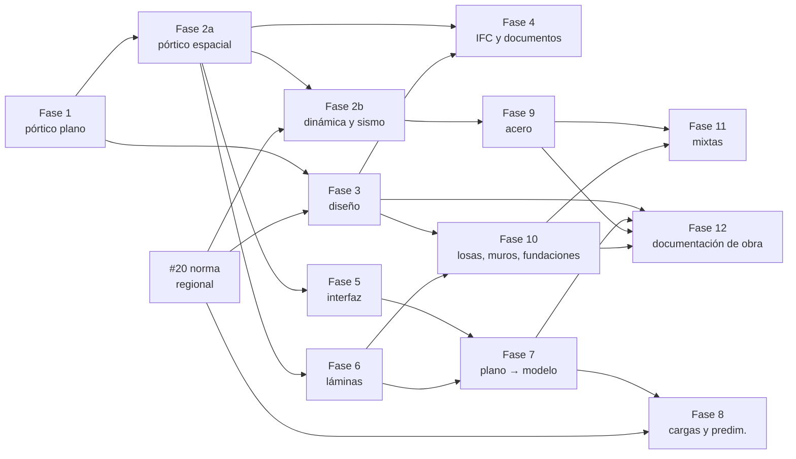

# Hoja de ruta de Nervi

_Plan de desarrollo a partir de la Fase 1. Redactado el 2026-11-09, entrada [2026-11-09-10](bitacora/2026-11-09-10-hoja-de-ruta.md)._

Este documento baja a tareas concretas la hoja de ruta por fases de la [especificación técnica](especificacion-tecnica.md) §7. Cada fase es un **hito** (milestone) en GitHub y cada tarea es un **issue** con etiquetas, pensado para que estudiantes, cátedras y grupos de investigación puedan tomar una parte y entregarla completa.

- Qué está hecho hoy: [`ESTADO.md`](ESTADO.md).
- Qué se hizo y por qué: [`bitacora/`](bitacora/).
- Cómo aportar: [`CONTRIBUTING.md`](../CONTRIBUTING.md).

## Visión

_Ampliada el 2026-11-24, entrada [2026-11-24-13](bitacora/2026-11-24-13-vision-y-hoja-de-ruta.md)._

Nervi es un programa libre y colaborativo para que los ingenieros **diseñen, predimensionen y dimensionen estructuras de hormigón armado, acero y mixtas**, y entreguen la documentación de obra completa. El recorrido que guía este plan es el de un proyecto real:

1. El arquitecto entrega su plano en **DXF** (o IFC, si lo tiene). Nervi reconoce ejes, columnas, muros y losas y propone una estructura inicial, y sigue las revisiones del plano sin rehacer el modelo.
2. El ingeniero predimensiona, genera las cargas según la norma (uso, viento y sismo) y calcula el edificio: pórticos, losas y muros, fundaciones con los datos del suelo y elementos especiales (escaleras, tanques, contención).
3. Dimensiona y verifica cada elemento según norma, en hormigón armado, acero (barras y uniones) y mixtas, con verificaciones de servicio (derivas, flechas, vibraciones).
4. Entrega la memoria de cálculo, los cómputos métricos y el presupuesto, las planillas de armaduras y de doblado, los planos de detalle de hormigón (varillas, armados, cortes) y de acero (uniones y soldaduras) en láminas con rótulo en DXF y PDF, y un IFC estructural para coordinar con el arquitecto. Cada documento sabe qué versión del cálculo lo respalda.

El DWG queda fuera del alcance: se trabaja en DXF (decisión del 24/11/2026).

## Punto de partida

_Actualizado el 2026-11-24 (fechas ajustadas a lo hecho)._ La Fase 0 (repositorio, CI, reglas) y casi toda la Fase 1 están en `main`: motor de pórtico plano en Rust con API Python y todos los tipos de carga (trapezoidales, térmicas y momentos en el tramo), diagnóstico de mecanismos, biblioteca `verification/`, formato `.nrv`, memoria de cálculo en PDF e interfaz de escritorio con tema claro y nocturno, panel de estructura, preferencias y configuración del proyecto. Para cerrar la Fase 1 faltan ejemplos transcriptos de libros (#6) y el material didáctico (#10).

Las fases siguientes ya empezaron en paralelo: el pórtico espacial con brazos y diafragma rígido (Fase 2a), masas, análisis modal y espectro de respuesta (Fase 2b, el del plano también en la interfaz) y el diseño de vigas y columnas según ACI 318-19 con su etapa en la interfaz (Fase 3, experimental). En paralelo avanza la integración con agentes de IA: la persona conecta su propia IA, que consulta el proyecto abierto y deja propuestas que ella aplica o descarta, con el panel del asistente ya en la ventana (ver la línea transversal más abajo). El detalle está en [`ESTADO.md`](ESTADO.md).

## Principios que valen para todas las fases

- **Rendimiento (regla prioritaria).** Todo cálculo que recorra barras, nudos, combinaciones o puntos (análisis, diseño, envolventes, diagramas de interacción) va en Rust y se expone a Python con la misma API; Python queda para la interfaz, la memoria PDF, los ejemplos y los prototipos. Cada migración se mide antes y después con el banco de tiempos (`scripts/medir_diseno.py`) y pasa las mismas pruebas. Plan aprobado el 19/11/2026: fases 0 (banco de tiempos), 1 (columnas en Rust) y 2 (flexión de vigas en Rust) hechas: el pórtico de referencia pasó de 132 s a 2,4 s. Cortante y servicio quedaron en Python porque se midió que no pesan (menos de 1 ms por viga). Las fases 3 y 4 no se hacen por ahora: medido en un pórtico de 750 barras, envolventes y acceso a diagramas pesan 0,1 s de 12 s y el diseño ya usa todos los núcleos; el resto del tiempo es la búsqueda de la armadura óptima de columnas, que queda como está (decisión del 19/11/2026). **Exactitud:** ninguna optimización baja tolerancias ni exactitud; toda migración da exactamente los mismos resultados.
- **Interfaz.** Un único sistema de diseño ([`diseno-interfaz.md`](diseno-interfaz.md)), con tema claro por defecto y oscuro de la marca; los cambios de diseño se acuerdan con una muestra visual. Los íconos de cada fase ya están reservados en el [catálogo de íconos](iconos.md).
- **Documentación al día.** Cada aporte actualiza en el mismo PR el README y sus traducciones, `ESTADO.md`, este plan, el sitio y lo que corresponda ([`CONTRIBUTING.md`](../CONTRIBUTING.md) §Documentación al día).

## Hitos

Cada tarea y cada hito lleva su estado:

| Ícono | Qué significa |
|:-:|---|
| ✅ | Hecho: funciona, está verificado y se puede usar. |
| 🧪 | Hecho, pero **experimental o preliminar**: funciona y tiene pruebas, pero todavía no lo revisó un ingeniero o no está verificado con ejemplos publicados. No usar para proyecto. |
| 🚧 | En desarrollo: ya empezó y falta terminarlo. |
| ⬜ | Pendiente: todavía no empezó (o espera una decisión). |

| Hito | Entregable | Criterio de salida | Depende de | Horizonte tentativo | Estado al 24/11/2026 |
|---|---|---|---|---|---|
| **Fase 1 · Cierre del pórtico plano** | Cargas trapezoidales, momentos y térmicas; biblioteca `verification/`; material didáctico | Todos los tipos de carga de la §3 con casos analíticos (error < 1e-9); casos de libros en `verification/` corriendo en el CI | — | Nov 2026 – ene 2027 | 🚧 Casi completa: faltan ejemplos transcriptos de libros (#6) y el material didáctico (#10) |
| **Fase 2a · Pórtico espacial** | Barra 12×12, contrato v2, brazos rígidos, diafragma rígido | Ejemplos 3D publicados reproducidos; un pórtico 3D plano da lo mismo que el motor 2D | Fase 1 | Motor en nov 2026; verificación e interfaz 3D, 1.er semestre 2027 | 🧪 Hecha y preliminar, solo desde Python; falta la verificación con ejemplos publicados (#15) y la interfaz |
| **Fase 2b · Dinámica y sismo** | Masa, modal, espectro de respuesta, P-Δ | Frecuencias y cargas críticas contra soluciones cerradas; ejemplo espectral publicado reproducido | Fase 2a; norma sísmica (#20) | Modal y espectro en nov 2026; P-Δ y espectros normativos, 1.er semestre 2027 | 🧪 Masa, modal y espectro hechos (preliminar), también en la interfaz del plano; faltan P-Δ (#19) y el espectro normativo |
| **Fase 3 · Diseño de hormigón armado** | Combinaciones y envolventes, vigas (flexión y cortante) y columnas según ACI 318-19, primera norma regional | Ejemplos resueltos de libros o manuales reproducidos con < 0.5 %; revisión de un ingeniero estructural | Esfuerzos 2D (ya) o 3D; decisión de norma (#20) | Vigas y columnas en nov 2026; revisión de ingeniero y norma regional, 1.er semestre 2027 | 🧪 Combinaciones, vigas y columnas hechas (experimental); falta la revisión de un ingeniero y decidir la norma regional (#20) |
| **Fase 4 · IFC y documentos** | Importación IFC (analítica e idealizada), exportación de armaduras y de un IFC estructural, memoria PDF | Ida y vuelta IFC con un modelo real abierto en Revit o Tekla | Fase 2a para 3D, Fase 3 para armaduras, Fase 7 para el IFC estructural | Memoria PDF en nov 2026; IFC, 2028 | 🚧 En curso: la memoria PDF ya existe; IFC sin empezar. Los planos DXF pasaron a la Fase 12 |
| **Fase 5 · Interfaz gráfica** | Visor 3D y edición de modelos | Un usuario modela y calcula un edificio de 3 pisos sin escribir código | Fase 2a | Ventana y visor 3D en marcha desde nov 2026; edición gráfica en 2027 | 🚧 En marcha como vía paralela: ventana de escritorio, visor 3D y panel del asistente de IA; falta la edición gráfica (#31) |
| **Fase 6 · Láminas** | Elemento de lámina, mallado de losas y muros unido al pórtico, cargas de superficie | Placas de referencia (Timoshenko) dentro de la tolerancia | Fase 2a | 2.º semestre 2027 | ⬜ Sin empezar (objetivo firme desde el 24/11/2026) |
| **Fase 7 · Del plano de arquitectura al modelo** | Modelo físico (pisos, ejes, vigas, columnas, losas, muros), modelo de cálculo generado desde él, reconocimiento del DXF de arquitectura, revisiones del plano | Un edificio de 3 pisos sale de un DXF de arquitectura y da los mismos esfuerzos que armado a mano | Fase 2a, Fase 5 (#31); Fase 6 para losas y muros | Modelo físico, 1.er semestre 2027; reconocimiento del plano, 2.º semestre 2027 | ⬜ Sin empezar |
| **Fase 8 · Cargas y predimensionado** | Cargas por uso, viento y sismo según norma; predimensionado de losas, vigas, columnas y perfiles | Ejemplos resueltos publicados reproducidos con < 0.5 % | Fase 7; norma regional (#20) | Predimensionado y uso, 1.er semestre 2027; viento y sismo, 2.º semestre 2027 | ⬜ Sin empezar |
| **Fase 9 · Estructuras de acero** | Catálogo de perfiles, barras según AISC 360-22, uniones apernadas y soldadas y placas base | Ejemplos resueltos publicados reproducidos con < 0.5 %; revisión de un ingeniero estructural | Fase 2a, P-Δ (#19), combinaciones (#21) | Barras, 1.er semestre 2027; uniones, 2.º semestre 2027 | ⬜ Sin empezar |
| **Fase 10 · Losas, muros, fundaciones y elementos especiales** | Diseño de losas y muros, fundaciones con datos del suelo, escaleras, tanques y contención, derivas y vibraciones | Ejemplos resueltos publicados reproducidos con < 0.5 %; revisión de un ingeniero estructural | Fases 3 y 6 | 2028 | ⬜ Sin empezar |
| **Fase 11 · Estructuras mixtas** | Vigas y columnas mixtas (AISC 360-22 cap. I), losa colaborante | Ejemplos resueltos publicados reproducidos con < 0.5 %; revisión de un ingeniero estructural | Fases 3, 9 y 10 | 2028 | ⬜ Sin empezar |
| **Fase 12 · Documentación de obra** | Modelo de armado, planillas de armaduras y doblado, planos de detalle de hormigón y de taller de acero, láminas con rótulo en DXF y PDF, cómputos y presupuesto, control de versiones de la entrega | Un edificio de prueba sale con planos, planillas y cómputos que un ingeniero da por válidos para obra | Fase 3 (vigas y columnas), Fase 7; Fases 9 y 10 para acero, losas y fundaciones | Armado y planillas de vigas y columnas, 1.er semestre 2027; láminas y planos, 2.º semestre 2027 – 2028 | ⬜ Sin empezar (ya existe el detalle de armaduras de vigas, experimental) |

Los horizontes son **tentativos**: dependen de cuántas personas se sumen y siguen el calendario académico (semestres de marzo a julio y de agosto a diciembre). Se revisan al cerrar cada hito.

No hace falta terminar una fase para empezar la siguiente. El diseño según norma (Fase 3), la memoria de cálculo, la importación IFC analítica y el visor se pueden empezar ya sobre el motor 2D, porque solo consumen esfuerzos y geometría.

## Etapas propuestas

Ordenadas por dependencias. Las fechas son una propuesta (24/11/2026) y se revisan al cerrar cada etapa.

| Etapa | Qué entra | Horizonte |
|---|---|---|
| **1 · Base sólida** | Cerrar la Fase 1 (#6, #10), verificación 3D (#15), P-Δ (#19), norma regional (#20), revisión de ingeniería de la Fase 3, edición gráfica (#31) | Hasta marzo 2027 |
| **2 · Modelo físico y primeras entregas** | Modelo físico y modelo de cálculo (#73, #74), cargas por uso (#79), predimensionado (#82), perfiles y barras de acero (#83, #84), modelo de armado y planilla de vigas y columnas (#93, #29) | 1.er semestre 2027 |
| **3 · Del plano a la lámina** | Reconocer el DXF y sus revisiones (#75, #76), láminas (#32, #77, #78), viento y sismo (#80, #81), uniones de acero (#85), láminas de entrega (#95), cómputos (#96) | 2.º semestre 2027 |
| **4 · Edificio completo** | Losas, muros, fundaciones y especiales (#86 a #89), servicio (#90), mixtas (#91, #92), planos de taller (#94), control de entregas (#97), IFC (#25 a #27, #98) | 2028 |

## Tareas por hito

Etiquetas de tamaño: **BPA** = `buen-primer-aporte`, **PA** = `proyecto-academico`, **T** = `tesis-posible`.

### Fase 1 · Cierre del pórtico plano

| Estado | Issue | Tarea | Tamaño | Área |
|:-:|---|---|---|---|
| ✅  [#2](https://github.com/jeronimobareiro/nervi/issues/2) | Cargas trapezoidales y parciales en barras (hecho) | PA | motor |
| ✅  [#3](https://github.com/jeronimobareiro/nervi/issues/3) | Momentos puntuales en el tramo (hecho) | BPA | motor |
| ✅  [#4](https://github.com/jeronimobareiro/nervi/issues/4) | Cargas térmicas (uniforme y gradiente) (hecho) | PA | motor |
| ✅  [#5](https://github.com/jeronimobareiro/nervi/issues/5) | Biblioteca `verification/` ejecutada en el CI (hecho) | PA | verificación |
| 🚧  [#6](https://github.com/jeronimobareiro/nervi/issues/6) | Ejemplos resueltos de libros como casos de verificación (en curso) | BPA | verificación |
| ⬜  [#7](https://github.com/jeronimobareiro/nervi/issues/7) | Pruebas de propiedades (equilibrio en modelos aleatorios) | BPA | verificación |
| ⬜  [#8](https://github.com/jeronimobareiro/nervi/issues/8) | `mypy` en el CI | BPA | — |
| ✅  [#9](https://github.com/jeronimobareiro/nervi/issues/9) | Indicar qué nudo o GDL hace inestable un modelo (hecho) | PA | motor |
| ⬜  [#10](https://github.com/jeronimobareiro/nervi/issues/10) | Cuadernos didácticos de análisis matricial | BPA | documentación |

### Fase 2a · Pórtico espacial

| Estado | Issue | Tarea | Tamaño | Área |
|:-:|---|---|---|---|
| 🧪  [#11](https://github.com/jeronimobareiro/nervi/issues/11) | Barra 3D 12×12 con ejes locales (hecho, preliminar) | T | motor |
| 🧪  [#12](https://github.com/jeronimobareiro/nervi/issues/12) | Contrato de datos v2 y API Python 3D (hecho, preliminar) | PA | motor |
| 🧪  [#13](https://github.com/jeronimobareiro/nervi/issues/13) | Brazos rígidos (hecho, preliminar) | PA | motor |
| 🧪  [#14](https://github.com/jeronimobareiro/nervi/issues/14) | Diafragma rígido por piso (hecho, preliminar) | PA | motor |
| ⬜  [#15](https://github.com/jeronimobareiro/nervi/issues/15) | Verificación 3D contra ejemplos publicados | BPA | verificación |

### Fase 2b · Dinámica y sismo

| Estado | Issue | Tarea | Tamaño | Área |
|:-:|---|---|---|---|
| 🧪  [#16](https://github.com/jeronimobareiro/nervi/issues/16) | Matrices de masa concentrada y consistente (hecho, preliminar) | PA | motor |
| 🧪  [#17](https://github.com/jeronimobareiro/nervi/issues/17) | Análisis modal con participación de masa (hecho, preliminar) | T | motor |
| 🧪  [#18](https://github.com/jeronimobareiro/nervi/issues/18) | Espectro de respuesta (CQC y SRSS) (hecho, preliminar; falta el espectro normativo) | T | motor, normas |
| ⬜  [#19](https://github.com/jeronimobareiro/nervi/issues/19) | P-Δ con matriz geométrica | T | motor |

### Fase 3 · Diseño de hormigón armado

| Estado | Issue | Tarea | Tamaño | Área |
|:-:|---|---|---|---|
| ⬜  [#20](https://github.com/jeronimobareiro/nervi/issues/20) | Decidir las normas de hormigón y sismo para Paraguay | decisión | normas |
| 🧪  [#21](https://github.com/jeronimobareiro/nervi/issues/21) | Combinaciones de carga y envolventes (hecho, experimental) | PA | normas |
| 🧪  [#22](https://github.com/jeronimobareiro/nervi/issues/22) | Flexión de vigas según ACI 318-19 (hecho, experimental; cálculo en Rust) | PA | normas |
| 🧪  [#23](https://github.com/jeronimobareiro/nervi/issues/23) | Cortante de vigas según ACI 318-19 (hecho, experimental) | PA | normas |
| 🧪  [#24](https://github.com/jeronimobareiro/nervi/issues/24) | Columnas: interacción biaxial y esbeltez (hecho, experimental; cálculo en Rust) | T | normas |
| 🧪  — | Flechas, fisuración y detalle de armaduras de vigas (hecho, experimental; falta llevarlo a la etapa Diseño) | PA | normas |

Después de ACI 318-19 y la norma regional siguen CIRSOC 201, NBR 6118, NCh 430/433 y EN 1992-1-1 (especificación §5). El acero (AISC 360-22) tiene su propia Fase 9. Se abren como issues cuando haya un grupo interesado en cada una.

### Fase 4 · IFC y documentos

| Estado | Issue | Tarea | Tamaño | Área |
|:-:|---|---|---|---|
| ⬜  [#25](https://github.com/jeronimobareiro/nervi/issues/25) | Importar modelos analíticos IFC | PA | ifc |
| ⬜  [#26](https://github.com/jeronimobareiro/nervi/issues/26) | Idealizar el modelo analítico desde elementos físicos | T | ifc |
| ⬜  [#27](https://github.com/jeronimobareiro/nervi/issues/27) | Exportar armaduras (`IfcReinforcingBar`) | PA | ifc |
| 🚧  [#28](https://github.com/jeronimobareiro/nervi/issues/28) | Memoria de cálculo en PDF (en curso: falta la revisión de formato) | PA | documentación |
| ⬜  [#98](https://github.com/jeronimobareiro/nervi/issues/98) | Exportar un IFC estructural para coordinar con el arquitecto | PA | ifc |

### Fase 5 · Interfaz gráfica

Desde noviembre de 2026 la interfaz es una **vía paralela**: `nervi.gui` (PySide6) ya cubre el pórtico plano de la Fase 1 en una sola ventana y crece junto con cada fase del motor, con instaladores preliminares para Windows y Linux. Ya tiene la etapa Diseño, la pestaña Dinámica, el visor 3D opcional, un sistema de diseño propio con tema claro y oscuro ([`diseno-interfaz.md`](diseno-interfaz.md)), la barra lateral de menús, las ventanas de Preferencias y Configuración del proyecto y el panel *Estructura* con el árbol del modelo en secciones plegables. Sus próximos apartados (unidades con conversión, normas, análisis, memoria, empresa y firma, IA y complementos) entran a medida que exista lo que ajustan. Esta fase queda para lo que necesita la Fase 2a: llevar el pórtico espacial a la interfaz y al `.nrv`, y la edición gráfica de modelos. Regla: la interfaz no calcula ni guarda nada por su cuenta, solo usa `nervi` y `nervi.formato`.

| Estado | Issue | Tarea | Tamaño | Área |
|:-:|---|---|---|---|
| 🚧  [#30](https://github.com/jeronimobareiro/nervi/issues/30) | Prototipo de visor 3D (en curso: visor único de frente y 3D con giro tipo plato y brújula desde el 28/11/2026; falta mostrar `Modelo3D`) | PA | interfaz |
| ⬜  [#31](https://github.com/jeronimobareiro/nervi/issues/31) | Edición gráfica de modelos | T | interfaz |

### Fase 6 · Láminas

| Estado | Issue | Tarea | Tamaño | Área |
|:-:|---|---|---|---|
| ⬜  [#32](https://github.com/jeronimobareiro/nervi/issues/32) | Elemento de lámina para losas y muros | T | motor |
| ⬜  [#77](https://github.com/jeronimobareiro/nervi/issues/77) | Mallado de losas y muros y unión con el pórtico espacial | T | motor |
| 🚧  [#78](https://github.com/jeronimobareiro/nervi/issues/78) | Cargas de superficie en losas y su reparto (cargas por planta y reparto a vigas y muros por áreas tributarias hechos, en Rust y en la interfaz; faltan cargas en zonas y lineales sobre la losa y el camino con losas malladas) | PA | motor |

### Fase 7 · Del plano de arquitectura al modelo

| Estado | Issue | Tarea | Tamaño | Área |
|:-:|---|---|---|---|
| 🚧  [#73](https://github.com/jeronimobareiro/nervi/issues/73) | Modelo físico: pisos, ejes, vigas, columnas, losas y muros (datos, `.nrv`, API Python y edición con tablas, gestor de plantas y dibujo con el mouse hechos) | T | interfaz |
| ⬜  [#74](https://github.com/jeronimobareiro/nervi/issues/74) | Generar el modelo de cálculo desde el modelo físico | T | motor |
| ⬜  [#75](https://github.com/jeronimobareiro/nervi/issues/75) | Reconocer ejes, columnas, muros y losas en un DXF de arquitectura | T | planos |
| ⬜  [#76](https://github.com/jeronimobareiro/nervi/issues/76) | Comparar revisiones del plano de arquitectura y actualizar el modelo | PA | planos |

### Fase 8 · Cargas y predimensionado

| Estado | Issue | Tarea | Tamaño | Área |
|:-:|---|---|---|---|
| ⬜  [#79](https://github.com/jeronimobareiro/nervi/issues/79) | Cargas por uso del local según norma | PA | normas |
| ⬜  [#80](https://github.com/jeronimobareiro/nervi/issues/80) | Cargas de viento según norma | PA | normas |
| ⬜  [#81](https://github.com/jeronimobareiro/nervi/issues/81) | Fuerzas sísmicas estáticas y espectro normativo | PA | normas |
| ⬜  [#82](https://github.com/jeronimobareiro/nervi/issues/82) | Predimensionado de losas, vigas, columnas y perfiles | PA | normas |

### Fase 9 · Estructuras de acero

| Estado | Issue | Tarea | Tamaño | Área |
|:-:|---|---|---|---|
| ⬜  [#83](https://github.com/jeronimobareiro/nervi/issues/83) | Catálogo de perfiles de acero | BPA | normas |
| ⬜  [#84](https://github.com/jeronimobareiro/nervi/issues/84) | Verificación de barras de acero según AISC 360-22 | T | normas |
| ⬜  [#85](https://github.com/jeronimobareiro/nervi/issues/85) | Uniones de acero apernadas y soldadas y placas base | T | normas |
| ⬜  [#100](https://github.com/jeronimobareiro/nervi/issues/100) | Perfiles conformados en frío según AISI S100 (después de los laminados) | T | normas |

Los perfiles conformados en frío entran en esta fase después de los laminados (decisión del 25/11/2026, #100).

### Fase 10 · Losas, muros, fundaciones y elementos especiales

Después de las losas macizas entran las nervadas (#101), las pretensadas (#102) y las mixtas con chapa colaborante (steel deck, #92, Fase 11), decisión del 25/11/2026.

| Estado | Issue | Tarea | Tamaño | Área |
|:-:|---|---|---|---|
| ⬜  [#86](https://github.com/jeronimobareiro/nervi/issues/86) | Diseño de losas de hormigón armado (primero macizas) | PA | normas |
| ⬜  [#101](https://github.com/jeronimobareiro/nervi/issues/101) | Losas nervadas de hormigón armado | PA | normas |
| ⬜  [#102](https://github.com/jeronimobareiro/nervi/issues/102) | Losas pretensadas (postesadas y prefabricadas pretensadas) | T | normas |
| ⬜  [#87](https://github.com/jeronimobareiro/nervi/issues/87) | Diseño de muros de hormigón armado | PA | normas |
| ⬜  [#88](https://github.com/jeronimobareiro/nervi/issues/88) | Fundaciones con los datos del estudio de suelos | T | normas |
| ⬜  [#89](https://github.com/jeronimobareiro/nervi/issues/89) | Escaleras, tanques y muros de contención | PA | normas |
| ⬜  [#90](https://github.com/jeronimobareiro/nervi/issues/90) | Derivas de piso, flechas de losas y vibraciones de entrepisos | PA | normas |

### Fase 11 · Estructuras mixtas

| Estado | Issue | Tarea | Tamaño | Área |
|:-:|---|---|---|---|
| ⬜  [#91](https://github.com/jeronimobareiro/nervi/issues/91) | Vigas y columnas mixtas según AISC 360-22 cap. I | T | normas |
| ⬜  [#92](https://github.com/jeronimobareiro/nervi/issues/92) | Losa colaborante con chapa (steel deck) | PA | normas |

### Fase 12 · Documentación de obra

| Estado | Issue | Tarea | Tamaño | Área |
|:-:|---|---|---|---|
| ⬜  [#93](https://github.com/jeronimobareiro/nervi/issues/93) | Modelo de armado: posiciones, ganchos, empalmes y anclajes | PA | normas |
| ⬜  [#29](https://github.com/jeronimobareiro/nervi/issues/29) | Planos DXF de armado y planilla de doblado | PA | planos |
| ⬜  [#94](https://github.com/jeronimobareiro/nervi/issues/94) | Planos de taller de estructuras de acero con detalles de soldadura | T | planos |
| ⬜  [#95](https://github.com/jeronimobareiro/nervi/issues/95) | Láminas de entrega con rótulo en DXF y PDF | PA | planos |
| ⬜  [#96](https://github.com/jeronimobareiro/nervi/issues/96) | Cómputos métricos y presupuesto | PA | documentacion |
| ⬜  [#97](https://github.com/jeronimobareiro/nervi/issues/97) | Control de versiones de la entrega | PA | documentacion |

### Línea transversal · Integración con agentes de IA, API y complementos

Abierta el 24/11/2026, en paralelo a las fases y sin frenarlas. Objetivo: que la persona conecte el agente de IA que ya usa (Claude, ChatGPT, Gemini u otro) para cargar datos e interpretar resultados del programa abierto, y que la comunidad pueda escribir complementos, **sin que ninguno toque el motor**: la IA nunca produce un número de resultado, solo consulta a Nervi y propone cambios que la persona confirma. Etapas, cada una en su propio aporte:

1. ✅ Capa de proyecto sin Qt, `nervi.proyecto` (hecha): la comparten la interfaz, los scripts y las integraciones.
2. ✅ Resultados a precisión completa en JSON, `nervi.resultados` (hecha, [`formato-resultados.md`](formato-resultados.md)).
3. ✅ Deshacer, rehacer y propuestas de cambio con su origen (hecha: `Proyecto.proponer`, `aplicar`, `deshacer`, Ctrl+Z y Ctrl+Y en la interfaz, y módulo `historial` del `.nrv` para auditar los cambios que no hizo la persona).
4. ✅ Servidor MCP `nervi-mcp`, primero de solo lectura (hecha: `nervi.ia`, 10 herramientas de consulta, [`agentes-ia.md`](agentes-ia.md)).
5. ✅ Canal local con la ventana abierta, botón "Conectar con mi IA" y panel del asistente (hecha: canal local, selección, propuestas y panel del asistente sin chat en la barra lateral). La persona conversa en su propia app de IA, que no necesita clave de API.
6. ✅ Importar DXF con vista previa (hecha: `nervi.importar.dxf`, sin IA ni bibliotecas externas, y *Archivo › Importar DXF* con capas, unidad, tolerancia y vista previa; el agente también puede proponerlo con `proponer_dxf`).
7. ⬜ Complementos con *entry points*, permisos y camino a oficial, con su regla de licencia en `GOVERNANCE.md`.
8. ⬜ Chat dentro de Nervi, sobre las mismas herramientas, con la clave de API de la persona guardada en el llavero del sistema: primero Ollama (modelos locales, sin que los datos salgan de la computadora) y Claude, después los proveedores compatibles con la API de OpenAI.

## Colaboración con universidades

### Qué etiqueta mirar según el perfil

| Perfil | Etiqueta | Ejemplos |
|---|---|---|
| Estudiante de grado, primer aporte | `buen-primer-aporte` | Un caso de verificación de un libro, un momento puntual en el tramo |
| Trabajo práctico, final de materia o práctica profesional supervisada | `proyecto-academico` | Cargas térmicas, combinaciones, memoria PDF, visor |
| Tesis de grado o posgrado | `tesis-posible` | Barra 3D, análisis modal, columnas por fibras, láminas |
| Docente o ingeniero con experiencia en una norma | `revision-ingenieria` | Revisar y aprobar un módulo de diseño |

Las etiquetas de área (`motor`, `normas`, `ifc`, `interfaz`, `planos`, `verificacion`, `documentacion`) ayudan a cada cátedra a encontrar lo suyo: Análisis Estructural y Métodos Numéricos en `motor` y `verificacion`, Hormigón Armado en `normas`, Estructuras Metálicas también en `normas`, Dibujo y Representación Gráfica en `planos`, BIM e Informática en `ifc` e `interfaz`.

### Cómo se toma una tarea

1. Comentá en el issue quién sos, desde qué institución y en qué plazo pensás entregarlo. Un mantenedor te lo asigna para que nadie duplique el trabajo.
2. Si es un trabajo académico, indicá quién lo dirige o evalúa. El docente puede actuar como revisor técnico (ver [`GOVERNANCE.md`](../GOVERNANCE.md)).
3. Antes de un cambio grande, proponé el diseño en el issue. Para tesis conviene abrir además un issue de seguimiento con hitos intermedios.
4. Trabajá en PR chicos que lleguen con su prueba de verificación, su fuente citada y su entrada en la bitácora. Se puede abrir el PR como borrador y pedir ayuda.
5. Un issue asignado sin actividad durante 60 días vuelve a quedar libre, salvo que se acuerde otro plazo.

### Reglas que importan en trabajos académicos

- Los aportes se firman con el certificado de origen (DCO). Confirmá que el reglamento de tu universidad te permite publicar el código bajo GPL-3.0-or-later; el derecho de autor sigue siendo tuyo.
- Se citan las normas por artículo; no se transcriben textos ni tablas. Los datos numéricos de un ejemplo resuelto se pueden usar citando la fuente.
- Un módulo de diseño queda marcado como experimental hasta que lo apruebe un revisor técnico.
- Si la institución quiere un acuerdo formal (convenio, uso en clase), ver [`GOVERNANCE.md`](../GOVERNANCE.md) §Instituciones.

## Cómo se mantiene este plan

- Los hitos y etiquetas se definen en [`.github/hoja-de-ruta.json`](../.github/hoja-de-ruta.json). El flujo **Organizar hoja de ruta** (`.github/workflows/hoja-de-ruta.yml`) los crea o actualiza en GitHub y asigna cada issue a su hito según su etiqueta `fase-*`. Corre cuando cambia ese archivo en `main`, cuando se abre o se etiqueta un issue con una etiqueta `fase-*`, y también se puede lanzar a mano desde la pestaña Actions.
- Para sumar una tarea, abrí un issue con su etiqueta `fase-*`, una de tamaño y una de área, y agregala a la tabla de su hito en este documento.
- Al cerrar un hito, se actualiza esta tabla, [`ESTADO.md`](ESTADO.md) y la §7 de la especificación si cambió el alcance. Cambiar el orden de las fases es una decisión de alto impacto (ver `GOVERNANCE.md`).

## Decisiones abiertas

- **Norma regional prioritaria** para hormigón y sismo ([#20](https://github.com/jeronimobareiro/nervi/issues/20)). La toma el responsable del proyecto.
- **Biblioteca de autovalores** para el análisis modal: propia sobre `faer` o un binding con licencia compatible (se decide en [#17](https://github.com/jeronimobareiro/nervi/issues/17)).
- **Formulación de láminas**: MITC4 o DKT (se decide en [#32](https://github.com/jeronimobareiro/nervi/issues/32)).
