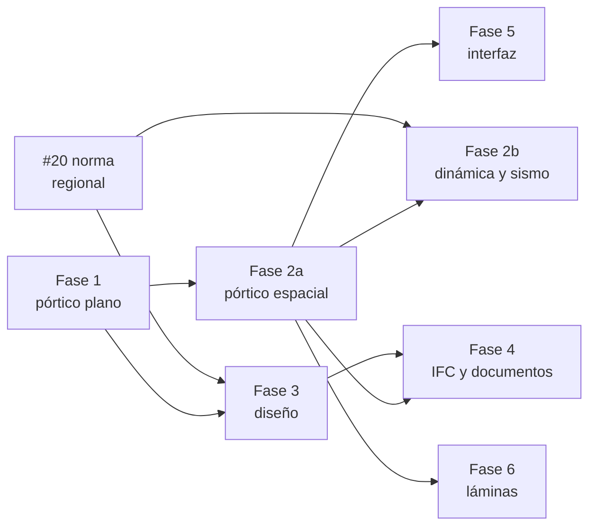

# Hoja de ruta de Nervi

_Plan de desarrollo a partir de la Fase 1. Redactado el 2026-11-09, entrada [2026-11-09-10](bitacora/2026-11-09-10-hoja-de-ruta.md)._

Este documento baja a tareas concretas la hoja de ruta por fases de la [especificación técnica](especificacion-tecnica.md) §7. Cada fase es un **hito** (milestone) en GitHub y cada tarea es un **issue** con etiquetas, pensado para que estudiantes, cátedras y grupos de investigación puedan tomar una parte y entregarla completa.

- Qué está hecho hoy: [`ESTADO.md`](ESTADO.md).
- Qué se hizo y por qué: [`bitacora/`](bitacora/).
- Cómo aportar: [`CONTRIBUTING.md`](../CONTRIBUTING.md).

## Punto de partida

La Fase 0 (repositorio, CI, reglas) y casi toda la Fase 1 están en `main`: motor de pórtico plano en Rust con API Python, cargas trapezoidales y parciales, 27 casos de verificación analítica, un pórtico de unas 8 000 barras resuelto en decenas de milisegundos, el formato de proyecto `.nrv` y una interfaz de escritorio preliminar. Para cerrar la Fase 1 faltan los momentos en el tramo, las cargas térmicas y la biblioteca de verificación.

## Hitos

| Hito | Entregable | Criterio de salida | Depende de | Horizonte tentativo |
|---|---|---|---|---|
| **Fase 1 · Cierre del pórtico plano** | Cargas trapezoidales, momentos y térmicas; biblioteca `verification/`; material didáctico | Todos los tipos de carga de la §3 con casos analíticos (error < 1e-9); casos de libros en `verification/` corriendo en el CI | — | Dic 2026 – feb 2027 |
| **Fase 2a · Pórtico espacial** | Barra 12×12, contrato v2, brazos rígidos, diafragma rígido | Ejemplos 3D publicados reproducidos; un pórtico 3D plano da lo mismo que el motor 2D | Fase 1 | 1.er semestre 2027 |
| **Fase 2b · Dinámica y sismo** | Masa, modal, espectro de respuesta, P-Δ | Frecuencias y cargas críticas contra soluciones cerradas; ejemplo espectral publicado reproducido | Fase 2a; norma sísmica (#20) | 2.º semestre 2027 |
| **Fase 3 · Diseño de hormigón armado** | Combinaciones y envolventes, vigas (flexión y cortante) y columnas según ACI 318-19, primera norma regional | Ejemplos resueltos de libros o manuales reproducidos con < 0.5 %; revisión de un ingeniero estructural | Esfuerzos 2D (ya) o 3D; decisión de norma (#20) | Empieza en paralelo en 2027 |
| **Fase 4 · IFC y documentos** | Importación IFC (analítica e idealizada), exportación de armaduras, memoria PDF, planos DXF | Ida y vuelta IFC con un modelo real abierto en Revit o Tekla | Fase 2a para 3D, Fase 3 para armaduras | 2027 – 2028 |
| **Fase 5 · Interfaz gráfica** | Visor 3D y edición de modelos | Un usuario modela y calcula un edificio de 3 pisos sin escribir código | Fase 2a | 2028 |
| **Fase 6 · Láminas** | Losas y muros por elementos finitos | Placas de referencia (Timoshenko) dentro de la tolerancia | Fase 2a | Investigación, sin fecha |

Los horizontes son **tentativos**: dependen de cuántas personas se sumen y siguen el calendario académico (semestres de marzo a julio y de agosto a diciembre). Se revisan al cerrar cada hito.

No hace falta terminar una fase para empezar la siguiente. El diseño según norma (Fase 3), la memoria de cálculo, la importación IFC analítica y el visor se pueden empezar ya sobre el motor 2D, porque solo consumen esfuerzos y geometría.

## Tareas por hito

Etiquetas de tamaño: **BPA** = `buen-primer-aporte`, **PA** = `proyecto-academico`, **T** = `tesis-posible`.

### Fase 1 · Cierre del pórtico plano

| Issue | Tarea | Tamaño | Área |
|---|---|---|---|
| [#2](https://github.com/jeronimobareiro/nervi/issues/2) | Cargas trapezoidales y parciales en barras (hecho) | PA | motor |
| [#3](https://github.com/jeronimobareiro/nervi/issues/3) | Momentos puntuales en el tramo | BPA | motor |
| [#4](https://github.com/jeronimobareiro/nervi/issues/4) | Cargas térmicas (uniforme y gradiente) | PA | motor |
| [#5](https://github.com/jeronimobareiro/nervi/issues/5) | Biblioteca `verification/` ejecutada en el CI | PA | verificación |
| [#6](https://github.com/jeronimobareiro/nervi/issues/6) | Ejemplos resueltos de libros como casos de verificación | BPA | verificación |
| [#7](https://github.com/jeronimobareiro/nervi/issues/7) | Pruebas de propiedades (equilibrio en modelos aleatorios) | BPA | verificación |
| [#8](https://github.com/jeronimobareiro/nervi/issues/8) | `mypy` en el CI | BPA | — |
| [#9](https://github.com/jeronimobareiro/nervi/issues/9) | Indicar qué nudo o GDL hace inestable un modelo | PA | motor |
| [#10](https://github.com/jeronimobareiro/nervi/issues/10) | Cuadernos didácticos de análisis matricial | BPA | documentación |

### Fase 2a · Pórtico espacial

| Issue | Tarea | Tamaño | Área |
|---|---|---|---|
| [#11](https://github.com/jeronimobareiro/nervi/issues/11) | Barra 3D 12×12 con ejes locales | T | motor |
| [#12](https://github.com/jeronimobareiro/nervi/issues/12) | Contrato de datos v2 y API Python 3D | PA | motor |
| [#13](https://github.com/jeronimobareiro/nervi/issues/13) | Brazos rígidos | PA | motor |
| [#14](https://github.com/jeronimobareiro/nervi/issues/14) | Diafragma rígido por piso | PA | motor |
| [#15](https://github.com/jeronimobareiro/nervi/issues/15) | Verificación 3D contra ejemplos publicados | BPA | verificación |

### Fase 2b · Dinámica y sismo

| Issue | Tarea | Tamaño | Área |
|---|---|---|---|
| [#16](https://github.com/jeronimobareiro/nervi/issues/16) | Matrices de masa concentrada y consistente | PA | motor |
| [#17](https://github.com/jeronimobareiro/nervi/issues/17) | Análisis modal con participación de masa | T | motor |
| [#18](https://github.com/jeronimobareiro/nervi/issues/18) | Espectro de respuesta (CQC y SRSS) | T | motor, normas |
| [#19](https://github.com/jeronimobareiro/nervi/issues/19) | P-Δ con matriz geométrica | T | motor |

### Fase 3 · Diseño de hormigón armado

| Issue | Tarea | Tamaño | Área |
|---|---|---|---|
| [#20](https://github.com/jeronimobareiro/nervi/issues/20) | Decidir las normas de hormigón y sismo para Paraguay | decisión | normas |
| [#21](https://github.com/jeronimobareiro/nervi/issues/21) | Combinaciones de carga y envolventes | PA | normas |
| [#22](https://github.com/jeronimobareiro/nervi/issues/22) | Flexión de vigas según ACI 318-19 | PA | normas |
| [#23](https://github.com/jeronimobareiro/nervi/issues/23) | Cortante de vigas según ACI 318-19 | PA | normas |
| [#24](https://github.com/jeronimobareiro/nervi/issues/24) | Columnas: interacción biaxial por fibras y esbeltez | T | normas |

Después de ACI 318-19 y la norma regional siguen CIRSOC 201, NBR 6118, NCh 430/433, EN 1992-1-1 y AISC 360 (especificación §5). Se abren como issues cuando haya un grupo interesado en cada una.

### Fase 4 · IFC y documentos

| Issue | Tarea | Tamaño | Área |
|---|---|---|---|
| [#25](https://github.com/jeronimobareiro/nervi/issues/25) | Importar modelos analíticos IFC | PA | ifc |
| [#26](https://github.com/jeronimobareiro/nervi/issues/26) | Idealizar el modelo analítico desde elementos físicos | T | ifc |
| [#27](https://github.com/jeronimobareiro/nervi/issues/27) | Exportar armaduras (`IfcReinforcingBar`) | PA | ifc |
| [#28](https://github.com/jeronimobareiro/nervi/issues/28) | Memoria de cálculo en PDF | PA | documentación |
| [#29](https://github.com/jeronimobareiro/nervi/issues/29) | Planos DXF y planilla de doblado | PA | — |

### Fase 5 · Interfaz gráfica

Desde noviembre de 2026 la interfaz es una **vía paralela**: `nervi.gui` (PySide6) ya cubre el pórtico plano de la Fase 1 en una sola ventana y crece junto con cada fase del motor, con instaladores preliminares para Windows y Linux. Esta fase queda para lo que necesita la Fase 2a: visor 3D y edición gráfica de modelos espaciales. Regla: la interfaz no calcula ni guarda nada por su cuenta, solo usa `nervi` y `nervi.formato`.

| Issue | Tarea | Tamaño | Área |
|---|---|---|---|
| [#30](https://github.com/jeronimobareiro/nervi/issues/30) | Prototipo de visor 3D | PA | interfaz |
| [#31](https://github.com/jeronimobareiro/nervi/issues/31) | Edición gráfica de modelos | T | interfaz |

### Fase 6 · Láminas

| Issue | Tarea | Tamaño | Área |
|---|---|---|---|
| [#32](https://github.com/jeronimobareiro/nervi/issues/32) | Elemento de lámina para losas y muros | T | motor |

## Colaboración con universidades

### Qué etiqueta mirar según el perfil

| Perfil | Etiqueta | Ejemplos |
|---|---|---|
| Estudiante de grado, primer aporte | `buen-primer-aporte` | Un caso de verificación de un libro, un momento puntual en el tramo |
| Trabajo práctico, final de materia o práctica profesional supervisada | `proyecto-academico` | Cargas térmicas, combinaciones, memoria PDF, visor |
| Tesis de grado o posgrado | `tesis-posible` | Barra 3D, análisis modal, columnas por fibras, láminas |
| Docente o ingeniero con experiencia en una norma | `revision-ingenieria` | Revisar y aprobar un módulo de diseño |

Las etiquetas de área (`motor`, `normas`, `ifc`, `interfaz`, `verificacion`, `documentacion`) ayudan a cada cátedra a encontrar lo suyo: Análisis Estructural y Métodos Numéricos en `motor` y `verificacion`, Hormigón Armado en `normas`, BIM e Informática en `ifc` e `interfaz`.

### Cómo se toma una tarea

1. Comentá en el issue quién sos, desde qué institución y en qué plazo pensás entregarlo. Un mantenedor te lo asigna para que nadie duplique el trabajo.
2. Si es un trabajo académico, indicá quién lo dirige o evalúa. El docente puede actuar como revisor técnico (ver [`GOVERNANCE.md`](../GOVERNANCE.md)).
3. Antes de un cambio grande, proponé el diseño en el issue. Para tesis conviene abrir además un issue de seguimiento con hitos intermedios.
4. Trabajá en PR chicos que lleguen con su prueba de verificación, su fuente citada y su entrada en la bitácora. Se puede abrir el PR como borrador y pedir ayuda.
5. Un issue asignado sin actividad durante 60 días vuelve a quedar libre, salvo que se acuerde otro plazo.

### Reglas que importan en trabajos académicos

- Los aportes se firman con el certificado de origen (DCO). Confirmá que el reglamento de tu universidad te permite publicar el código bajo GPL-3.0-or-later; el derecho de autor sigue siendo tuyo.
- Se citan las normas por artículo; no se transcriben textos ni tablas. Los datos numéricos de un ejemplo resuelto se pueden usar citando la fuente.
- Un módulo de diseño queda marcado como experimental hasta que lo apruebe un revisor técnico.
- Si la institución quiere un acuerdo formal (convenio, uso en clase), ver [`GOVERNANCE.md`](../GOVERNANCE.md) §Instituciones.

## Cómo se mantiene este plan

- Los hitos y etiquetas se definen en [`.github/hoja-de-ruta.json`](../.github/hoja-de-ruta.json). El flujo **Organizar hoja de ruta** (`.github/workflows/hoja-de-ruta.yml`) los crea o actualiza en GitHub y asigna cada issue a su hito según su etiqueta `fase-*`. Corre cuando cambia ese archivo en `main`, cuando se abre o se etiqueta un issue con una etiqueta `fase-*`, y también se puede lanzar a mano desde la pestaña Actions.
- Para sumar una tarea, abrí un issue con su etiqueta `fase-*`, una de tamaño y una de área, y agregala a la tabla de su hito en este documento.
- Al cerrar un hito, se actualiza esta tabla, [`ESTADO.md`](ESTADO.md) y la §7 de la especificación si cambió el alcance. Cambiar el orden de las fases es una decisión de alto impacto (ver `GOVERNANCE.md`).

## Decisiones abiertas

- **Norma regional prioritaria** para hormigón y sismo ([#20](https://github.com/jeronimobareiro/nervi/issues/20)). La toma el responsable del proyecto.
- **Biblioteca de autovalores** para el análisis modal: propia sobre `faer` o un binding con licencia compatible (se decide en [#17](https://github.com/jeronimobareiro/nervi/issues/17)).
- **Formulación de láminas**: MITC4 o DKT (se decide en [#32](https://github.com/jeronimobareiro/nervi/issues/32)).
