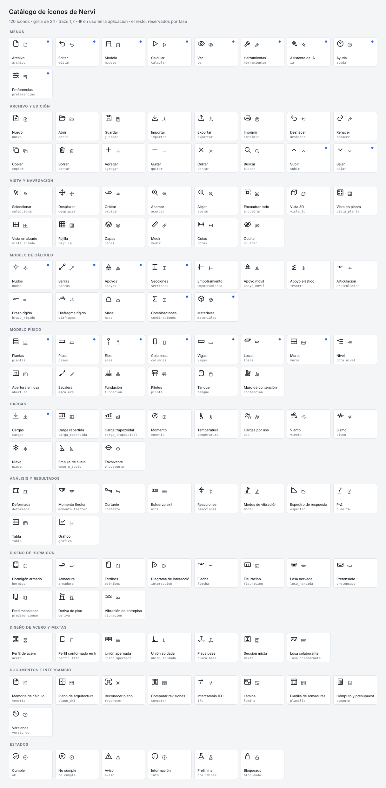

# Catálogo de íconos

_Creado el 2026-11-27, entrada [2026-11-27-01](bitacora/2026-11-27-01-catalogo-de-iconos.md)._

Todos los íconos de la interfaz salen de un único lugar: [`python/nervi/gui/iconos.py`](../python/nervi/gui/iconos.py). Ahí están los que la aplicación ya muestra y los **reservados** para las fases de la hoja de ruta, con la fase o el issue que los necesita. Cualquier aporte que necesite un ícono lo toma de este catálogo; no dibuja uno propio dentro de su módulo.



La lámina en tema oscuro está en [`img/iconos-oscuro.png`](img/iconos-oscuro.png). Un punto azul marca los íconos que ya están en uso.

## Cómo se usa

```python
from nervi.gui import estilo, iconos

# Botón con sus tres estados: reposo (texto_2), marcado (acento) y deshabilitado.
boton.setIcon(iconos.qicon("vista_3d", estilo.actual, 20, boton.devicePixelRatioF()))
boton.setIconSize(QSize(20, 20))
boton.setToolTip(iconos.CATALOGO["vista_3d"].nombre)

# Imagen suelta en un color del tema.
etiqueta.setPixmap(iconos.pixmap("aviso", estilo.AVISO_TEXTO, 16, etiqueta.devicePixelRatioF()))

# SVG en texto, para la hoja de estilos o un archivo.
texto = iconos.svg("memoria", estilo.TEXTO_2, 24)
```

- `CATALOGO[clave]` devuelve un `Icono` con `nombre` (para la ayuda emergente y el nombre accesible), `grupo`, `cuerpo` (los trazos SVG), `uso` y `en_uso`.
- `pixmap()` guarda en caché cada combinación de ícono, color, tamaño y escala de pantalla.
- Al cambiar de tema, volvé a pedir los íconos con el tema nuevo (como hace `VentanaPrincipal._iconos_riel`).

## Reglas de la familia

Son las de la barra lateral, aprobadas el 19/11/2026 junto con la [línea de diseño](diseno-interfaz.md):

- **Grilla de 24 × 24** (`viewBox="0 0 24 24"`), con un margen de unas 2 unidades. Solo trazo, sin relleno, con puntas y uniones redondeadas. Los íconos del árbol del modelo conservan su grilla original de 16 (campo `rejilla`) para verse exactamente igual que antes.
- **Trazo de 1,7 unidades**, que se ve de 1,7 px a 24 px y de 1,4 px a 20 px. A 16 px o menos se engrosa a 2,1 unidades para que la línea siga midiendo 1,4 px, como en el árbol.
- **Tamaños:** 24 px en la barra lateral, 20 px en botones de herramientas, 18 px en botones agrupados (`segmento`), 16 px en árboles, tablas y menús.
- **Color siempre del tema** de [`estilo.py`](../python/nervi/gui/estilo.py): `texto_2` en reposo, `acento` activo o marcado, `deshabilitado` inactivo. Los estados usan sus colores (`ok`, `negativo`, `aviso_texto`). Nunca un color fijo dentro del cuerpo del ícono.
- **Dibujos propios.** No se copian íconos ni capturas de otros programas ([`AGENTS.md`](../AGENTS.md) §4).

## Cómo se agrega o se cambia un ícono

1. Si el que necesitás está **reservado**, usalo y pasalo a `en_uso=True` en el mismo PR, con el lugar donde aparece en `uso`.
2. Si no existe, agregalo al grupo que corresponda en `iconos.py`, siguiendo las reglas de arriba, y sumalo a la tabla de esta página.
3. Para cambiar el dibujo de uno en uso o agregar uno nuevo, mostrá antes una muestra en los dos temas y esperá el acuerdo, como cualquier cambio de diseño. La lámina se regenera con:

   ```bash
   python scripts/lamina_iconos.py            # escribe docs/img/iconos-claro.png y -oscuro.png
   ```

4. `tests/test_iconos.py` controla que las claves no se repitan, que los cuerpos tengan solo formas sin color ni relleno, que los íconos en uso dibujen igual que antes y que esta página liste todo el catálogo.

## Lista completa

### Menús

| Clave | Nombre | Estado | Uso |
|---|---|---|---|
| `archivo` | Archivo | en uso | Barra lateral |
| `editar` | Editar | en uso | Barra lateral (flecha de deshacer) |
| `modelo` | Modelo | en uso | Barra lateral |
| `calcular` | Calcular | en uso | Barra lateral |
| `ver` | Ver | en uso | Barra lateral |
| `herramientas` | Herramientas | en uso | Barra lateral |
| `ia` | Asistente de IA | en uso | Barra lateral |
| `ayuda` | Ayuda | en uso | Barra lateral |
| `preferencias` | Preferencias | en uso | Barra lateral |

### Archivo y edición

| Clave | Nombre | Estado | Uso |
|---|---|---|---|
| `nuevo` | Nuevo | reservado | Menú Archivo |
| `abrir` | Abrir | reservado | Menú Archivo |
| `guardar` | Guardar | reservado | Menú Archivo |
| `importar` | Importar | reservado | Menú Archivo: DXF, IFC (#25, #75) |
| `exportar` | Exportar | reservado | Menú Archivo: IFC, DXF, PDF (#29, #95, #98) |
| `imprimir` | Imprimir | reservado | Memoria y láminas (#28, #95) |
| `deshacer` | Deshacer | reservado | Edición gráfica (#31) |
| `rehacer` | Rehacer | reservado | Edición gráfica (#31) |
| `copiar` | Copiar | reservado | Edición gráfica, copiar plantas (#31, #73) |
| `borrar` | Borrar | reservado | Tablas y edición gráfica (#31) |
| `agregar` | Agregar | reservado | Tablas y listas |
| `quitar` | Quitar | reservado | Tablas y listas |
| `cerrar` | Cerrar | reservado | Paneles y diálogos |
| `buscar` | Buscar | reservado | Paleta de comandos, tablas |
| `subir` | Subir | en uso | Modo Edificio: subir una planta |
| `bajar` | Bajar | en uso | Modo Edificio: bajar una planta |

### Vista y navegación

| Clave | Nombre | Estado | Uso |
|---|---|---|---|
| `seleccionar` | Seleccionar | reservado | Edición gráfica (#31) |
| `desplazar` | Desplazar | reservado | Visor 3D y planta (#30) |
| `orbitar` | Orbitar | reservado | Visor 3D (#30) |
| `acercar` | Acercar | reservado | Visor 3D y planta (#30) |
| `alejar` | Alejar | reservado | Visor 3D y planta (#30) |
| `encuadrar` | Encuadrar todo | reservado | Visor 3D y planta (#30) |
| `vista_3d` | Vista 3D | reservado | Visor 3D (#30) |
| `vista_planta` | Vista en planta | reservado | Modo Edificio y visor (#30, #73) |
| `vista_alzado` | Vista en alzado | reservado | Modo Edificio y visor (#30, #73) |
| `rejilla` | Rejilla | reservado | Edición gráfica (#31) |
| `capas` | Capas | reservado | Capas del plano DXF (#75) |
| `medir` | Medir | reservado | Edición gráfica (#31) |
| `cotas` | Cotas | reservado | Planta y láminas (#95) |
| `ocultar` | Ocultar | reservado | Árbol del modelo y capas |

### Modelo de cálculo

| Clave | Nombre | Estado | Uso |
|---|---|---|---|
| `nudos` | Nudos | en uso | Árbol del modelo |
| `barras` | Barras | en uso | Árbol del modelo |
| `apoyos` | Apoyos | en uso | Árbol del modelo |
| `secciones` | Secciones | en uso | Árbol del modelo |
| `empotramiento` | Empotramiento | reservado | Edición de apoyos (#31) |
| `apoyo_movil` | Apoyo móvil | reservado | Edición de apoyos (#31) |
| `resorte` | Apoyo elástico | reservado | Apoyos elásticos y suelo (#88) |
| `articulacion` | Articulación | reservado | Liberaciones en extremos de barra (#31) |
| `brazo_rigido` | Brazo rígido | reservado | Brazos rígidos (#13) |
| `diafragma` | Diafragma rígido | reservado | Diafragma por piso (#14) |
| `masa` | Masa | reservado | Masas para dinámica (#16) |
| `combinaciones` | Combinaciones | en uso | Árbol del modelo |
| `materiales` | Materiales | en uso | Árbol del modelo físico |

### Modelo físico

| Clave | Nombre | Estado | Uso |
|---|---|---|---|
| `plantas` | Plantas | en uso | Modo Edificio: gestor de plantas |
| `pisos` | Pisos | en uso | Árbol del modelo físico |
| `ejes` | Ejes | en uso | Árbol del modelo físico |
| `columnas` | Columnas | en uso | Árbol del modelo físico |
| `vigas` | Vigas | en uso | Árbol del modelo físico |
| `losas` | Losas | en uso | Árbol del modelo físico |
| `muros` | Muros | en uso | Árbol del modelo físico |
| `cota_nivel` | Nivel | reservado | Cotas de piso en alzado (#73) |
| `abertura` | Abertura en losa | reservado | Huecos de losas y muros (#73, #86) |
| `escalera` | Escalera | reservado | Escaleras (#89) |
| `fundacion` | Fundación | reservado | Fundaciones (#88) |
| `pilote` | Pilotes | reservado | Fundaciones profundas (#88) |
| `tanque` | Tanque | reservado | Tanques (#89) |
| `contencion` | Muro de contención | reservado | Muros de contención (#89) |

### Cargas

| Clave | Nombre | Estado | Uso |
|---|---|---|---|
| `cargas` | Cargas | en uso | Árbol del modelo; carga puntual |
| `carga_repartida` | Carga repartida | reservado | Cargas en barras (#31) |
| `carga_trapezoidal` | Carga trapezoidal | reservado | Cargas trapezoidales en barras (#2, #31) |
| `momento` | Momento | reservado | Momentos puntuales (#3, #31) |
| `temperatura` | Temperatura | reservado | Cargas térmicas (#4) |
| `uso` | Cargas por uso | reservado | Cargas por uso del local (#79) |
| `viento` | Viento | reservado | Viento según norma (#80) |
| `sismo` | Sismo | reservado | Sismo estático y espectro normativo (#81) |
| `nieve` | Nieve | reservado | Caso de carga S (#79) |
| `empuje_suelo` | Empuje de suelo | reservado | Caso H, muros de contención (#89) |
| `envolvente` | Envolvente | reservado | Combinaciones y envolventes (#21) |

### Análisis y resultados

| Clave | Nombre | Estado | Uso |
|---|---|---|---|
| `deformada` | Deformada | reservado | Vista de resultados |
| `momento_flector` | Momento flector | reservado | Diagramas de esfuerzos |
| `cortante` | Cortante | reservado | Diagramas de esfuerzos |
| `axil` | Esfuerzo axil | reservado | Diagramas de esfuerzos |
| `reacciones` | Reacciones | reservado | Resultados de apoyos |
| `modal` | Modos de vibración | reservado | Análisis modal (#17) |
| `espectro` | Espectro de respuesta | reservado | Espectro de respuesta (#18, #81) |
| `p_delta` | P-Δ | reservado | Segundo orden P-Δ (#19) |
| `tabla` | Tabla | reservado | Tablas del modelo y resultados |
| `grafico` | Gráfico | reservado | Curvas y gráficos de resultados |

### Diseño de hormigón

| Clave | Nombre | Estado | Uso |
|---|---|---|---|
| `hormigon` | Hormigón armado | reservado | Etapa Diseño: hormigón (#22, #24) |
| `armadura` | Armadura | reservado | Modelo de armado (#93) |
| `estribos` | Estribos | reservado | Cortante y detalle de vigas (#23, #93) |
| `interaccion` | Diagrama de interacción | reservado | Columnas: interacción biaxial (#24) |
| `flecha` | Flecha | reservado | Servicio: flechas (#90) |
| `fisuracion` | Fisuración | reservado | Servicio: fisuración (#90) |
| `losa_nervada` | Losa nervada | reservado | Losas nervadas (#101) |
| `pretensado` | Pretensado | reservado | Losas pretensadas (#102) |
| `predimensionar` | Predimensionar | reservado | Predimensionado (#82) |
| `deriva` | Deriva de piso | reservado | Servicio: derivas (#90) |
| `vibracion` | Vibración de entrepiso | reservado | Servicio: vibraciones (#90) |

### Diseño de acero y mixtas

| Clave | Nombre | Estado | Uso |
|---|---|---|---|
| `acero` | Perfil de acero | reservado | Catálogo de perfiles y barras de acero (#83, #84) |
| `perfil_frio` | Perfil conformado en frío | reservado | Perfiles conformados en frío (#100) |
| `union_apernada` | Unión apernada | reservado | Uniones de acero (#85) |
| `union_soldada` | Unión soldada | reservado | Uniones de acero, planos de taller (#85, #94) |
| `placa_base` | Placa base | reservado | Placas base (#85) |
| `mixta` | Sección mixta | reservado | Vigas y columnas mixtas (#91) |
| `losa_colaborante` | Losa colaborante | reservado | Losa colaborante con chapa (#92) |

### Documentos e intercambio

| Clave | Nombre | Estado | Uso |
|---|---|---|---|
| `memoria` | Memoria de cálculo | reservado | Memoria PDF (#28) |
| `plano_dxf` | Plano de arquitectura | reservado | Importar DXF y reconocer el plano (#75) |
| `reconocer` | Reconocer plano | reservado | Reconocer ejes, columnas, muros y losas (#75) |
| `comparar` | Comparar revisiones | reservado | Revisiones del plano (#76) |
| `ifc` | Intercambio IFC | reservado | Importar y exportar IFC (#25, #27, #98) |
| `lamina` | Lámina | reservado | Láminas con rótulo (#95) |
| `planilla` | Planilla de armaduras | reservado | Planillas de armaduras y doblado (#29) |
| `computo` | Cómputo y presupuesto | reservado | Cómputos métricos y presupuesto (#96) |
| `versiones` | Versiones | reservado | Control de versiones de la entrega (#97) |

### Estados

| Clave | Nombre | Estado | Uso |
|---|---|---|---|
| `ok` | Cumple | reservado | Verificaciones que cumplen |
| `no_cumple` | No cumple | reservado | Verificaciones que no cumplen |
| `aviso` | Aviso | reservado | Nudo inestable, avisos del cálculo |
| `info` | Información | reservado | Notas y ayudas |
| `preliminar` | Preliminar | reservado | Módulos experimentales sin revisión |
| `bloqueado` | Bloqueado | reservado | Elementos fijados, versiones cerradas (#97) |

