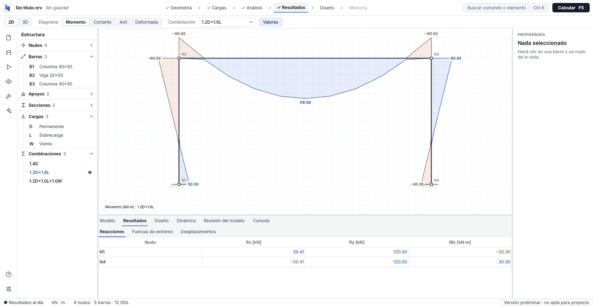
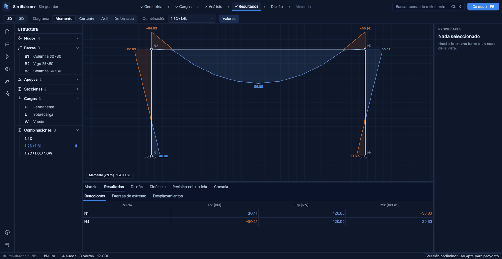

---
hide:
  - navigation
  - toc
---

# Nervi { .nv-oculto }

Software libre para calcular estructuras.

Nervi analiza pórticos por el método de los elementos finitos y muestra reacciones, esfuerzos y deformaciones. Es gratuito, de código abierto y cada resultado se compara con una solución conocida.

[Descargar](descargar.md){ .md-button .md-button--primary }
[Primeros pasos](primeros-pasos.md){ .md-button }

[¿Por qué se llama Nervi?](por-que-nervi.md){ .nv-porque }

{ .nv-captura .nv-claro }
{ .nv-captura .nv-oscuro }

!!! warning "Versión preliminar, no apta para proyecto"
    Nervi está en desarrollo. Calcula pórticos planos y espaciales con análisis lineal elástico; el espacial y la dinámica son preliminares y el diseño de hormigón armado según ACI 318-19 es experimental hasta que lo revise un ingeniero estructural. Asiste al ingeniero, no reemplaza su criterio ni su firma.

-   **Verificable**

    Cada tipo de cálculo se compara con una fórmula conocida y cita su fuente. Podés revisar cómo llega a cada número y ver los [casos verificados](casos-verificados.md).

-   **Libre y gratuito**

    Licencia GPL-3.0. Podés usarlo, enseñar con él, estudiarlo y mejorarlo, sin pagar licencias.

-   **Hecho con universidades**

    Estudiantes, docentes e ingenieros pueden sumar trabajos prácticos, tesis o revisiones. Mirá [cómo participar](participar/contribuir.md).

## Qué hace hoy

- **Pórticos planos** con barras, articulaciones, cerchas, apoyos fijos o elásticos y asentamientos.
- **Pórticos espaciales (3D)**, en versión preliminar: barras de 12 grados de libertad, brazos rígidos y diafragma rígido por piso.
- **Cargas** en nudos y en barras: uniformes, puntuales, trapezoidales o parciales, momentos concentrados y térmicas.
- **Casos y combinaciones** de carga, por ejemplo 1.2D + 1.6L.
- **Resultados**: reacciones, diagramas de axil, cortante y momento, y deformada, en 2D y en un visor 3D. Al pasar el cursor por una barra se leen los valores en ese punto. Si el modelo es un mecanismo, indica qué nudo se mueve sin rigidez.
- **Análisis dinámico**: modos de vibración, participación de masa y espectro de respuesta (CQC y SRSS), en versión preliminar.
- **Diseño de hormigón armado según ACI 318-19**, experimental: vigas (flexión, cortante, flechas y detalle de armaduras) y columnas (flexocompresión biaxial y esbeltez), cada verificación con su artículo.
- **Modelo físico del edificio**, en versión preliminar: pisos, ejes, columnas, vigas, losas macizas y muros que se dibujan con el mouse en cada planta, con enganche a extremos, ejes y grilla, o se cargan en tablas, con un gestor para agregar, mover y copiar plantas. Las cargas de cada planta se reparten de las losas a las vigas por áreas tributarias. Todavía no genera el modelo de cálculo.
- **Memoria de cálculo en PDF** con geometría, cargas, diagramas, diseño y análisis dinámico.
- **Interfaz de escritorio** en una sola ventana, con panel de estructura, tablas o dibujo con el mouse para cargar el modelo (nudos, barras, apoyos y cargas), tema claro y nocturno, y uso desde Python para quien programa.
- **Asistente de IA a tu manera**: conectás la IA que ya usás (por el estándar MCP) para consultar el modelo y los resultados. Solo propone cambios que vos aplicás o descartás, y cada número lo calcula el motor de Nervi, nunca la IA.
- **Proyectos** guardados en archivos `.nrv` y decenas de casos de verificación contra soluciones conocidas.

## Qué viene

La meta es que el ingeniero reciba el plano de arquitectura en DXF y entregue la estructura calculada con su documentación completa: memoria, cómputos, planillas de armaduras y planos de detalle de hormigón y de acero. En el camino vienen efectos de segundo orden (P-Δ), normas y espectros regionales (CIRSOC, NBR, NCh, Eurocódigo), edición gráfica del modelo, losas y muros, cargas de viento y sismo, predimensionado, estructuras de acero (AISC 360) y mixtas, fundaciones, intercambio con programas BIM (IFC), complementos de la comunidad y un chat dentro de Nervi. El orden y las tareas están en la [hoja de ruta](hoja-de-ruta.md).

## Para seguir leyendo

- [Descargar e instalar](descargar.md)
- [Primeros pasos](primeros-pasos.md): tu primer pórtico, con la interfaz o con Python
- [Documentación técnica](tecnica/especificacion.md): cómo calcula, convenciones de signos y formato de archivo
- [Cómo participar](participar/contribuir.md)
