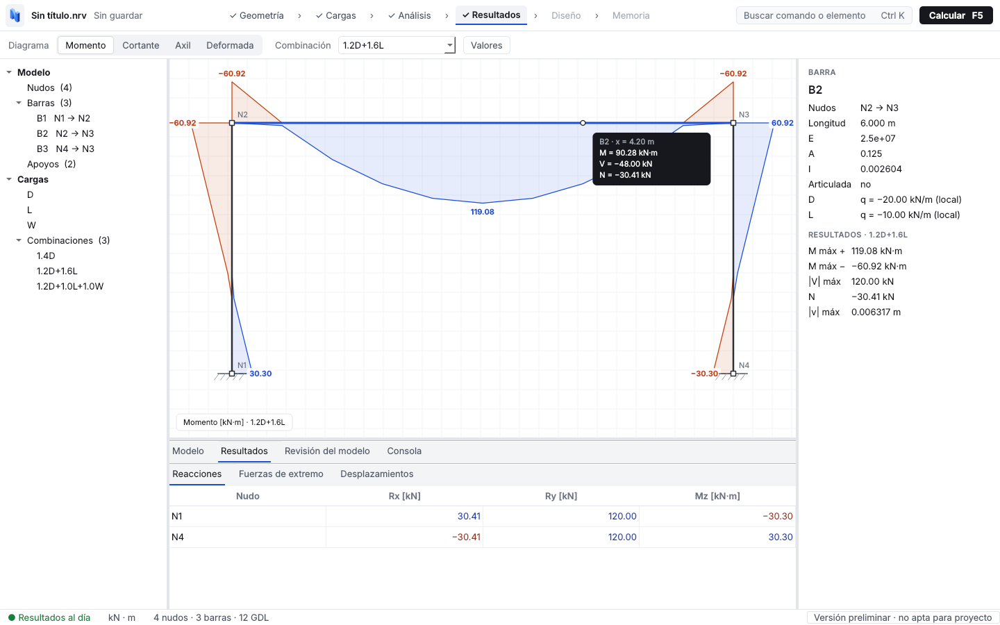

---
hide:
  - navigation
  - toc
---

# Nervi { .nv-oculto }

Software libre para calcular estructuras.

Nervi analiza pórticos por el método de los elementos finitos y muestra reacciones, esfuerzos y deformaciones. Es gratuito, de código abierto y cada resultado se compara con una solución conocida.

[Descargar](descargar.md){ .md-button .md-button--primary }
[Primeros pasos](primeros-pasos.md){ .md-button }

{ .nv-captura }

!!! warning "Versión preliminar, no apta para proyecto"
    Nervi está en desarrollo. Hoy calcula pórticos planos con análisis lineal elástico; todavía no dimensiona según normas. Asiste al ingeniero, no reemplaza su criterio ni su firma.

-   **Verificable**

    Cada tipo de cálculo se compara con una fórmula conocida y cita su fuente. Podés revisar cómo llega a cada número.

-   **Libre y gratuito**

    Licencia GPL-3.0. Podés usarlo, enseñar con él, estudiarlo y mejorarlo, sin pagar licencias.

-   **Hecho con universidades**

    Estudiantes, docentes e ingenieros pueden sumar trabajos prácticos, tesis o revisiones. Mirá [cómo participar](participar/contribuir.md).

## Qué hace hoy

- **Pórticos planos** con barras, articulaciones, cerchas, apoyos fijos o elásticos y asentamientos.
- **Cargas** en nudos y en barras: uniformes, puntuales y trapezoidales o parciales.
- **Casos y combinaciones** de carga, por ejemplo 1.2D + 1.6L.
- **Resultados**: reacciones, diagramas de axil, cortante y momento, y deformada. Al pasar el cursor por una barra se leen los valores en ese punto.
- **Interfaz de escritorio** en una sola ventana, con tablas para cargar el modelo, o uso desde Python para quien programa.
- **Proyectos** guardados en archivos `.nrv`.

## Qué viene

Pórticos en 3D, análisis sísmico, diseño de hormigón armado según norma, intercambio con programas BIM (IFC) y memoria de cálculo. El orden y las tareas están en la [hoja de ruta](hoja-de-ruta.md).

## Para seguir leyendo

- [Descargar e instalar](descargar.md)
- [Primeros pasos](primeros-pasos.md): tu primer pórtico, con la interfaz o con Python
- [Documentación técnica](tecnica/especificacion.md): cómo calcula, convenciones de signos y formato de archivo
- [Cómo participar](participar/contribuir.md)
